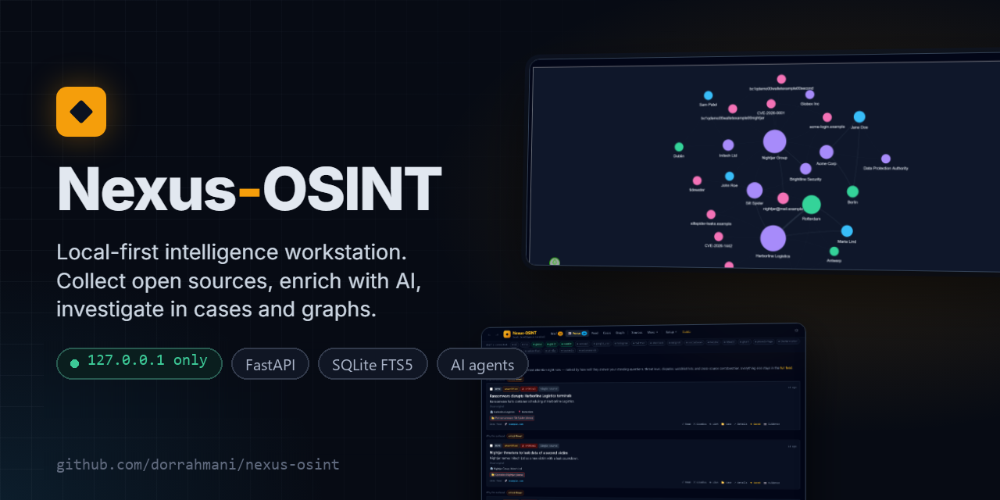
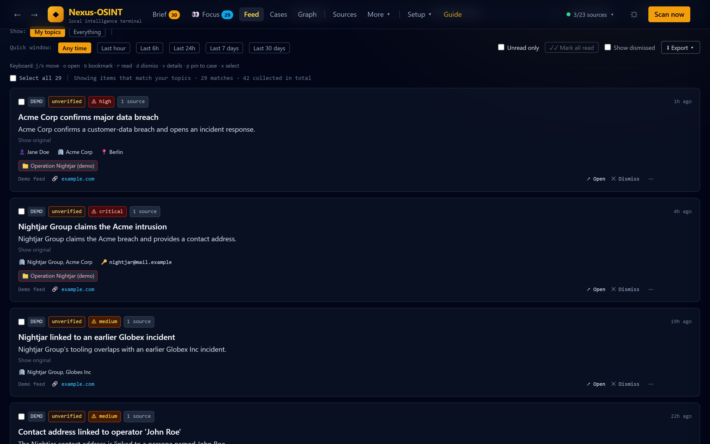
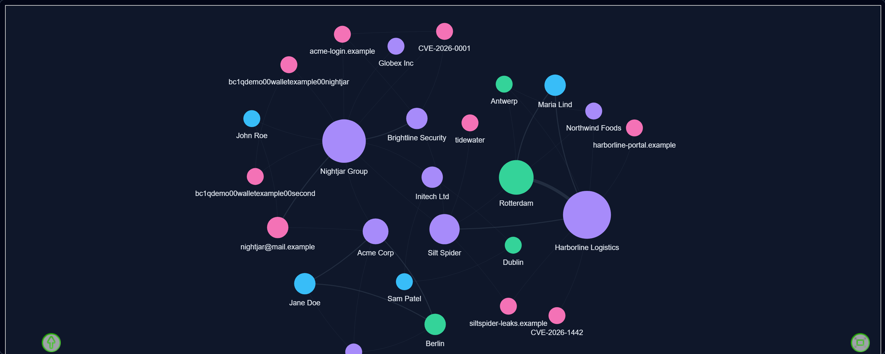
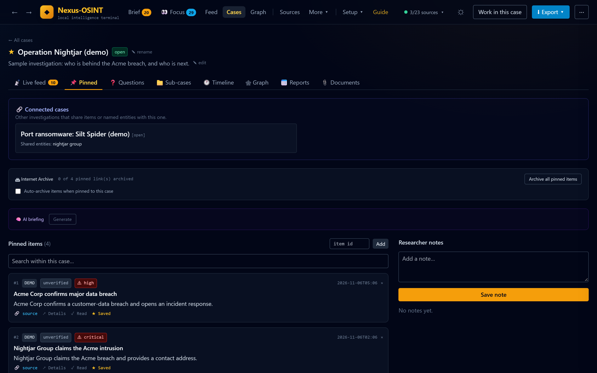
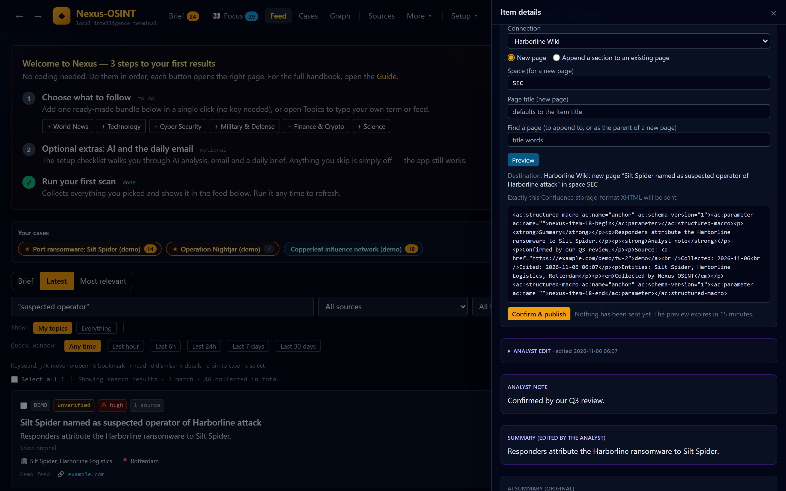

<div align="center">



# Nexus-OSINT

**The OSINT workstation that never leaves your machine.**<br>
Collect open sources, enrich them with AI, and investigate in cases and graphs.

[](https://github.com/dorrahmani/nexus-osint/actions/workflows/ci.yml)
[](https://github.com/dorrahmani/nexus-osint/releases/latest)
[](LICENSE)


[**Download**](https://github.com/dorrahmani/nexus-osint/releases/latest) · [Quickstart](#quickstart) · [Tour](docs/TOUR.md) · [Docs](#documentation) · [Security](SECURITY.md)

</div>

https://github.com/user-attachments/assets/6b622d66-14a5-49e0-b5a6-598554d5243a

<p align="center"><sub>One minute: a single sentence opens a full investigation and its relationship graph. The demo runs on live public sources; names of private individuals are blurred.</sub></p>

## Why

Open-source material is scattered across feeds, platforms and one-off tools. Hosted
platforms fix that, but want your queries and findings on their servers. Nexus-OSINT
is the opposite trade: everything runs on `127.0.0.1`, your data is one SQLite
file, and every outbound connection is logged and auditable.

## Highlights

| | |
|---|---|
| **Collect** | RSS, Google News, Reddit and GDELT with no keys; optional Twitter/X, Telegram, SERPAPI and any HTTP API without code |
| **Your own data** | PDF, Word, Excel, PowerPoint, email, images (OCR), ZIPs, intranet pages, Confluence, Obsidian, Notion, Slack, Drive and SharePoint |
| **Investigate** | Cases, a relationship graph, entity dossiers, a daily brief and a "Focus" view of what needs your eyes |
| **Sherlock** | An assistant that opens cases, runs scans and builds reports from one sentence, inside an allow-list fence |
| **Publish back** | Edit a finding and send it to Confluence, Obsidian or the knowledge pool, always after a preview |
| **Private by design** | Closed-network ready, encrypted evidence, nothing leaves unless you allow it, an outbound activity log you can export |
| **AI optional** | Gemini, OpenAI, Anthropic, Grok, or a fully local model. No key? Everything still works by hand |

<p align="center">
  
  
</p>
<p align="center">
  
  
</p>
<p align="center"><sub>Screenshots use the built-in, entirely fictional demo dataset (<b>Load demo data</b> on the empty feed). <a href="docs/TOUR.md">See the full tour →</a></sub></p>

## Quickstart

**Windows:** download the installer from [Releases](https://github.com/dorrahmani/nexus-osint/releases/latest), run it, and open the desktop shortcut.

**Docker:**

```bash
docker run -p 127.0.0.1:8000:8000 -v nexus-data:/app/data ghcr.io/dorrahmani/nexus-osint:latest
```

Keep the `127.0.0.1:` prefix: it is what keeps the app reachable from this machine only.

**From source** (Python 3.11+):

```bash
python -m venv .venv && source .venv/bin/activate   # Windows: .venv\Scripts\activate
pip install -r requirements.txt
cp .env.example .env                                 # Windows: copy .env.example .env
uvicorn nexus.web.app:app --host 127.0.0.1 --port 8000
```

Open <http://127.0.0.1:8000> and click **Load demo data**. A missing API key or CLI
tool just turns one feature off; it never crashes the app.

## Documentation

| | |
|---|---|
| [User Guide](docs/USER_GUIDE.md) | Day-to-day use, task by task |
| [Guided tour](docs/TOUR.md) | Every screen, and why it exists |
| [Features](docs/FEATURES.md) | Full catalogue and configuration reference |
| [Ingestion](docs/INGESTION.md) | Uploads, web pages, closed networks, custom APIs, connectors |
| [Publishing](docs/PUBLISHING.md) | Writing results back to Confluence, Obsidian and the knowledge pool |
| [Engineering notes](docs/ENGINEERING.md) | Architecture, trade-offs, security model, testing |
| [Developer Guide](docs/DEVELOPER_GUIDE.md) | Module map and extension points |
| [Responsible use](docs/RESPONSIBLE_USE.md) | What it is for, and what it cannot do |
| [Roadmap](docs/ROADMAP.md) · [Changelog](CHANGELOG.md) · [Contributing](CONTRIBUTING.md) | |

## Security in one paragraph

The server binds to `127.0.0.1` only, with CSRF and DNS-rebinding checks, a strict
CSP with no inline script, and an SSRF guard on every user-supplied URL. Uploads and
evidence can be encrypted at rest (AES-256-GCM). Secrets live only in `.env`. Release
installers are built from a leak-scanned source archive. Details and how to report a
vulnerability: [SECURITY.md](SECURITY.md).

## Built by

**Dor Rahmani**, a CS & Economics student at Tel Aviv University. Feedback and
issues are welcome.

[MIT licensed](LICENSE)
