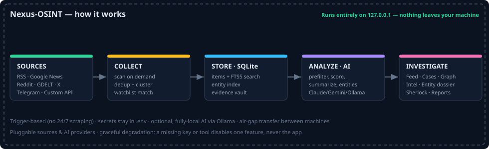

# Engineering notes

Architecture, trade-offs, what went wrong, the security model and how it is tested.

[← Back to the README](../README.md)

## Architecture



A scan runs collect -> deduplicate -> watchlist match -> AI analysis -> requirement
scoring. All SQL lives in the `nexus/storage/` package (one module per domain, re-exported
from `nexus.storage`); routes live in per-domain FastAPI routers under
`nexus/web/routers/`; the UI is server-rendered Jinja2 +
htmx with no JavaScript build step. See [docs/OVERVIEW.md](OVERVIEW.md) for
the end-to-end walk-through and [docs/DEVELOPER_GUIDE.md](DEVELOPER_GUIDE.md)
for the module map and extension points.

## Engineering decisions and trade-offs

- **SQLite (WAL) + FTS5 instead of a database server.** One user, one machine,
  read-heavy workload: a single file gives atomic writes, trigger-maintained
  full-text search, trivial backup and zero install friction. The cost is a
  single writer and no multi-user access; collaboration is explicitly out of
  scope for now (see the roadmap).
- **Trigger-based collection instead of a 24/7 daemon.** Scans run on demand, from
  an optional timer, or as a quiet gap-fill at startup. Nothing polls in the
  background, which keeps the resource footprint and the outbound-traffic surface
  small and predictable. The cost is that data is only as fresh as the last scan.
- **Graceful degradation as a rule.** Every source, tool and AI provider is
  optional and reports `is_available()`. A missing key or binary disables exactly
  one feature; with no AI configured, items are still collected, stored and
  searchable. A per-run budget cap and content-hash caching bound AI cost, and
  quota errors pause a scan instead of failing it.
- **AI agent safety by allow-list.** The in-app Sherlock can act on your
  data, but only through a fixed set of constructive local tools
  (`_ALLOWED_TOOLS` in `nexus/assistant.py`), with a hard cap on actions per turn.
  Anything else the model asks for is dropped and logged. It has no delete,
  settings, key or network tools. Model output and collected text are rendered as
  text, never HTML, because collected content is untrusted input and a prompt
  injection must not be able to become script execution.
- **A real entity index.** Entities extracted by the AI are stored as JSON on the
  analysis row *and* normalized into an `item_entities` table (indexed by
  canonical name, backfilled on upgrade). This turns "everything mentioning X"
  from a full scan into an index lookup and backs the entity dossier, the
  relationship graph and cross-linking.
- **Safe script embedding.** Where data must be embedded in an inline `<script>`,
  it goes through Jinja's `|tojson`, which escapes `<`, `>` and `&`. An earlier
  `json.dumps | safe` path allowed a `</script>` in a collected title to break
  out; it was fixed and is the pattern to follow.

## What went wrong along the way (and the fix)

Short notes from building it, because the failures shaped the design more than
the plan did.

| Problem found | Root cause | Fix |
|---|---|---|
| A collected headline containing `</script>` could break out of the AI-briefing page. | Item data was embedded with `json.dumps(...) \| safe`, which does not escape `<`. | Switched to Jinja's `\|tojson` and added a regression test. Model output is rendered with `textContent` only. |
| Gemini "flash" replies came back empty or cut off mid-JSON. | Newer models spend output tokens on internal reasoning before writing anything visible. | A bounded thinking budget is added *on top of* the requested output length, so the answer always keeps its room. |
| The same story syndicated by 30 outlets flooded the feed. | Exact-URL dedup misses rewrites and tracking parameters. | Items get an aggressively normalised `dedup_key`; near-duplicates collapse into one row with an "echoed N times" badge. |
| "Everything mentioning X" got slow as the database grew. | Entities lived only as JSON on each analysis row. | A normalised `item_entities` table indexed by canonical name, backfilled on upgrade. It now powers dossiers, the graph and connected cases. |
| An AI assistant that can "do things" is a prompt-injection target. | Collected posts are attacker-controlled text that reaches the model. | A hard allow-list of constructive local actions, a per-turn action cap, and text-only rendering. Unknown tool calls are dropped and logged. |

## Security model

- The server binds to `127.0.0.1` only. Requests get CSRF/DNS-rebinding checks and
  security headers; user-supplied URLs pass an SSRF guard before being fetched.
- **Collected data stays on your machine unless you configure a cloud AI
  provider.** In that case the text of items being analyzed is sent to that
  provider. Cloud AI providers (Gemini, OpenAI, Anthropic, Grok) are explicit
  opt-ins: nothing is sent until you add a key. Choose a local model (Ollama or a
  local OpenAI-compatible server such as LM Studio), or no AI, to keep analysis
  fully offline. Collection itself necessarily contacts the sources you enable.
- **The daily email brief is an explicit opt-in that sends data off the
  machine**: titles, summaries and links of new items go to the mail service you
  connect (your SMTP server, Resend or SendGrid), and only after a successful
  test email. App passwords and API keys only, no OAuth. The per-case daily
  reports themselves stay on disk and are served only on `127.0.0.1`.
- Reports and transfer bundles leave the machine only when you export them, and
  bundles never contain secrets.
- **Internet Archive captures are an explicit, per-action opt-in** (a one-time
  warning explains the trade-off): the item's URL is sent to archive.org and the
  resulting snapshot is public. Auto-archiving on pin is off unless you enable
  it for a case, and the whole feature can be switched off in Settings.
- **Backups never contain secrets.** Settings › Backup & restore writes one
  archive (optionally passphrase-encrypted) without API keys or passwords;
  restore validates the archive fully and saves the current state first.
- **Optional app password** (off by default, Settings): stops other people at
  the computer from opening the app. Forgot it? Delete its line from `.env`. See
  [SECURITY.md](SECURITY.md#app-password).
- **Optional encryption at rest** (off by default, Settings): uploaded
  documents and evidence screenshots are stored AES-256-GCM encrypted; the key
  is wrapped by your passphrase (plus a one-time recovery code, and optionally
  Windows DPAPI for automatic unlock) and never stored in the database, `.env`
  or logs. See [SECURITY.md](SECURITY.md#encryption-at-rest).
- Secrets live in `.env` only (git-ignored). They are never written to the
  database, shown back in the UI, or emitted in logs (a redaction filter scrubs
  configured keys).
- **Works fully offline.** The stylesheet, htmx and the graph library ship
  with the app; the UI makes no CDN or font requests, and the
  Content-Security-Policy only allows the app's own origin, with no inline
  script or eval. A test asserts that no page loads a remote asset.
- The Security center lists every outbound destination the app has contacted and
  flags any that is not a configured source or AI provider. Its **activity log**
  records each AI call, publish, e-mail, archive request and source fetch (metadata
  only, never content or keys), with filters and CSV export.
- **Server-side fetches are SSRF-guarded.** Only http(s) to public addresses,
  re-checked on every redirect hop. Internal hosts are reachable only when you
  list them explicitly (they then show as "Internal network (allowed)" in the
  Security center); loopback, link-local/cloud-metadata and the app's own port
  are never reachable.

Reporting vulnerabilities and the full policy: [SECURITY.md](../SECURITY.md).

## Testing and CI

```bash
pip install -r requirements-dev.txt
python -m pytest -q
```

The suite (about 1,050 tests) uses temporary SQLite databases and avoids the
network; it covers storage and dedup, source parsing, the assistant allow-list,
web hardening, export/transfer round-trips and route smoke tests.

GitHub Actions (`.github/workflows/ci.yml`) gates every push to `main` and every
pull request on:

- **test**: the suite on Python 3.11 and 3.12;
- **lint**: `ruff check .` (rule set and justified ignores in `pyproject.toml`);
- **types**: `mypy` over the `nexus` package;
- **assets**: rebuilds the Tailwind stylesheet and vendored htmx and fails if
  the committed copies have drifted.

Run the same checks locally with `ruff check .` and `mypy`, or install the git
hooks with `pre-commit install`. Dependabot proposes weekly updates for pip,
npm and GitHub Actions.
Contribution guidelines are in [CONTRIBUTING.md](../CONTRIBUTING.md).
