# A guided tour

Each screen exists because of a specific analyst problem.

[← Back to the README](../README.md)

Each screen below exists because of a specific analyst problem. The notes say
what you are looking at and why it was built that way.

### 1. Focus: "what needs my eyes right now?"

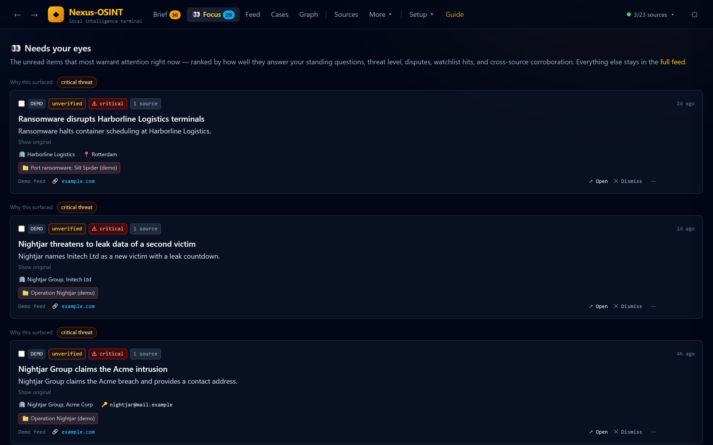

A scan can return hundreds of items, and an analyst cannot read them all. Focus
ranks the **unread** items by threat level, how well they answer your standing
questions, watchlist hits, disputes and cross-source corroboration. Every card
also states **why it surfaced**, so you can trust the ranking or disagree with
it. Nothing is hidden: everything else is still in the full feed.

### 2. The feed and the item drawer

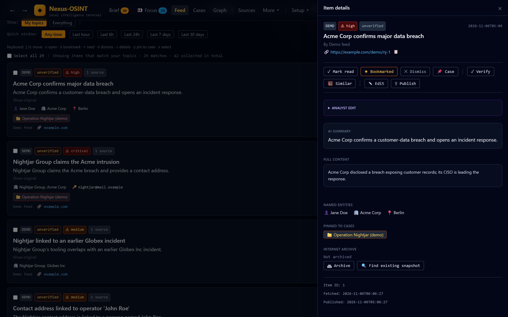

Each card carries a threat badge, a **verification state** (unverified until
corroborated), the AI summary in English, the original text one click away, and
the extracted people, organisations, places and identifiers. Opening an item
shows the full record plus actions: pin it to a case, **Verify** (finds independent
items about the same entities and asks the AI whether they corroborate or
contradict the claim) or **Similar** (local embedding search).
Summaries are labelled as AI output and the source link is always shown, because
an analyst has to be able to check the original. Threat levels and the 0-100
relevance scores are **model estimates, not calibrated probabilities**: they
order the reading queue, they do not replace judgement, which is also why every
item starts as *unverified* until other sources corroborate it.

### 3. Cases: an investigation, not a folder

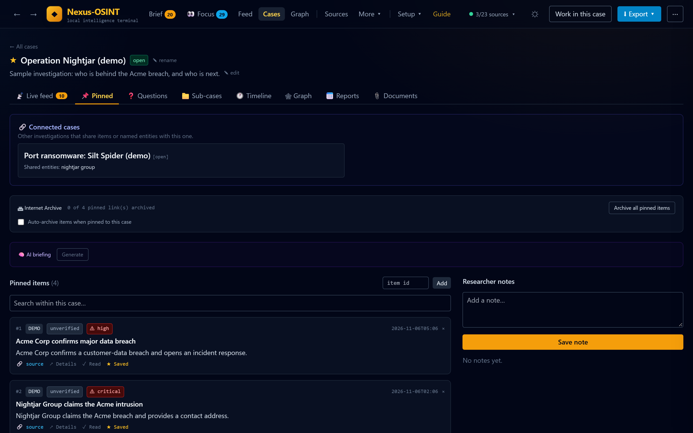

A case has tracking words that pull matching items into a live feed, pinned
evidence, standing questions, sub-cases, notes and a one-click AI briefing.
**Connected cases** appears automatically: here, Operation Nightjar is linked to
the Silt Spider ransomware case because both mention Nightjar Group. That cross-case
link is computed from the `item_entities` index, not stored by hand.

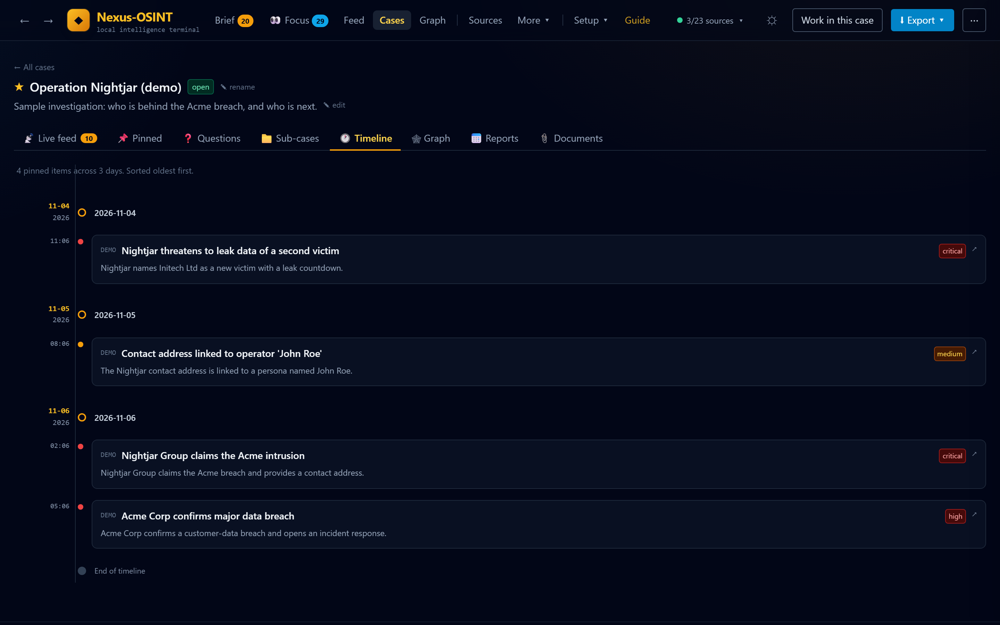

The timeline puts pinned evidence in order, which is usually the first thing a
reviewer asks for. Cases export to PDF/HTML, an Obsidian vault, or a hashed
evidence manifest.

### 4. Relationship graph

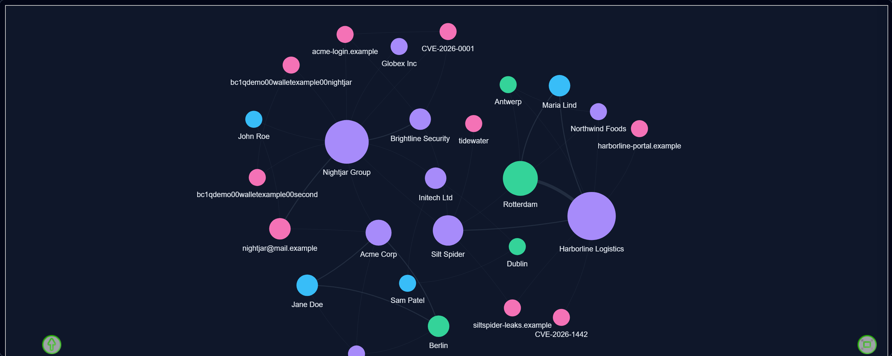

Two cases are selected here, and the graph shows the shared actor in the middle:
Nightjar Group links the Acme breach to the Harborline ransomware via shared
tooling. Node size is how often an entity is mentioned; edges are co-mentions.
Colours separate people, organisations, places and identifiers (wallets,
domains, CVEs, emails), so infrastructure reuse stands out. Every node opens
that entity's dossier.

### 5. Your own documents, searchable next to everything else

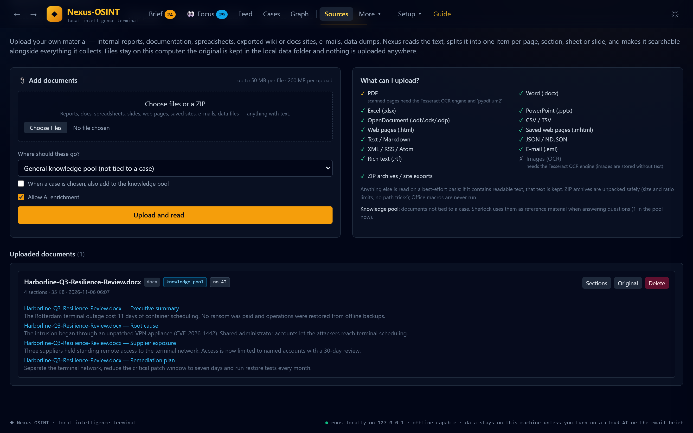

Upload a report, a spreadsheet, an exported wiki or a ZIP, and Nexus splits it
into one item per page, section, sheet or slide. Those items are searchable right
away, and Sherlock answers from them with citations you can click to open the
exact passage. With a cloud AI provider, a file stays away from it unless you
tick "Allow cloud AI" for that upload.

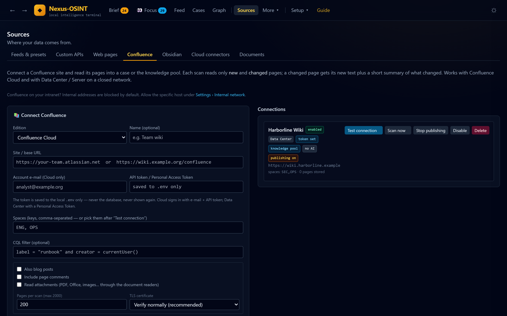

The same goes for the places your material already lives: Confluence (Cloud or
Data Center) and Obsidian vaults, plus read-only Notion, Slack, Google Drive and
SharePoint or OneDrive connectors. On a closed network, intranet hosts are
reached only after you allow-list them, and tokens stay in `.env`. Setup details:
[docs/INGESTION.md](INGESTION.md).

### 6. Edit, preview, publish

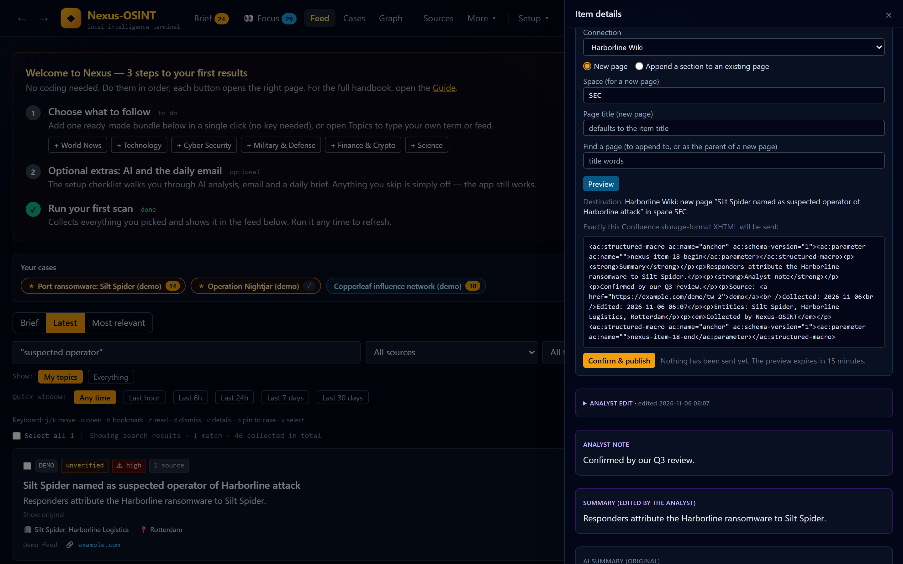

Edit an item without touching the collected original, or compose a write-up from
pinned items, then publish it to Confluence, a note in your Obsidian vault or the
knowledge pool. Writing is off until you allow it per connection, the preview is
exactly what will be sent, and only a click confirms it. Sherlock can prepare a
publish but has no path to confirm one. See [docs/PUBLISHING.md](PUBLISHING.md).

### 7. An activity log of what left the machine

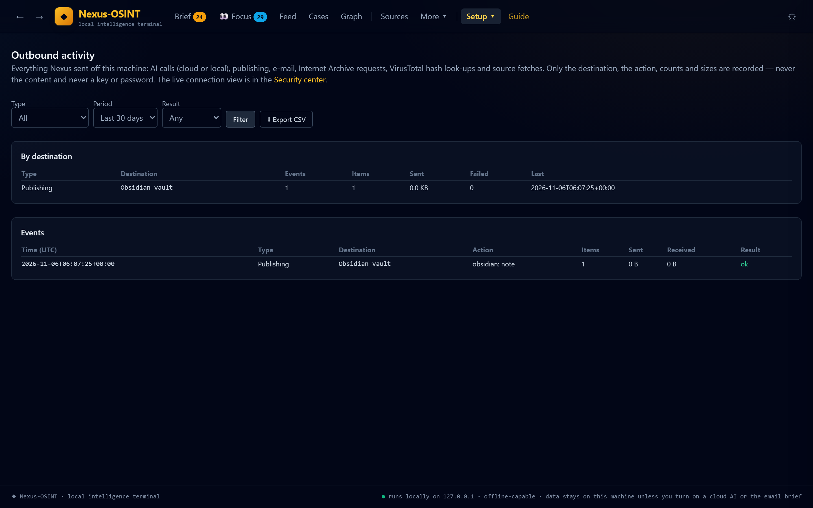

Local-first is easier to believe when you can check it. Outbound activity lists
AI calls, publishing, e-mail and source fetches by destination, with counts and
sizes but never the content, and exports to CSV. Stored files can also be
encrypted at rest (Settings > Encryption at rest, off by default).

<b>More of the tour: entity dossier, daily brief, the assistant, settings</b>

#### 8. Entity dossier and contextual pivots

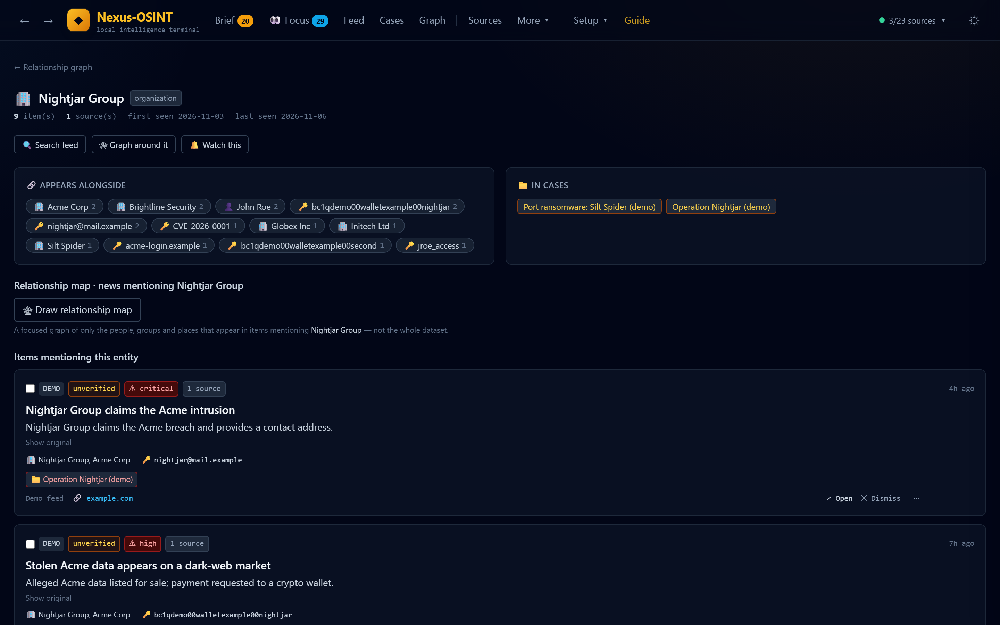

Everything known about one name on one page: first and last seen, the entities
it appears alongside, the cases it belongs to, and every item that mentions it.
When the entity is an identifier (email, username, phone, domain), the dossier
offers the matching **passive** OSINT tools (for example holehe for an email,
maigret for a username) as one-click pivots. Only tools that are installed are
offered, and targets are validated before they reach a subprocess.

#### 9. Daily brief

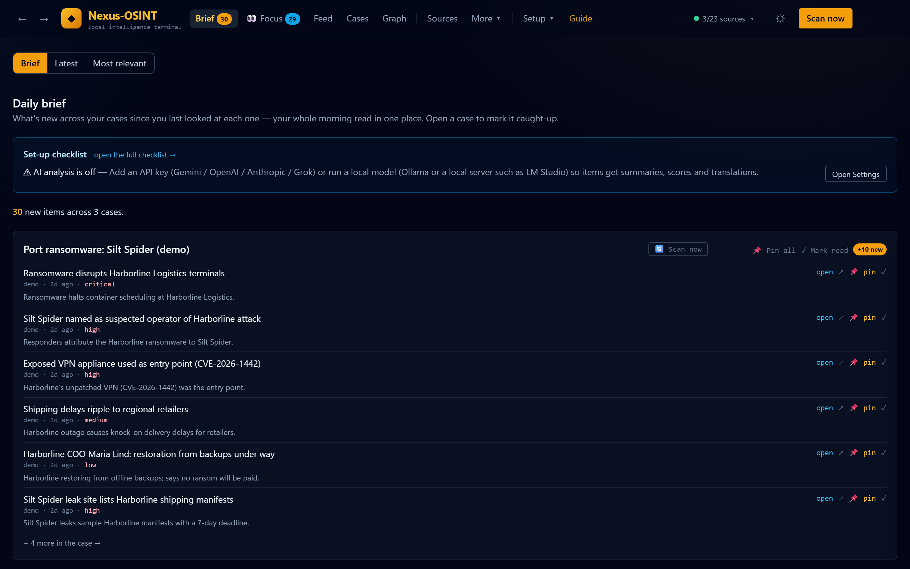

The morning read: what is new in each case since you last opened it. The set-up
checklist at the top says, in plain language, what is not configured yet (here,
AI analysis is off) instead of failing silently. Optionally, Sherlock emails a
written version of this brief every morning, and each case can save a daily
PDF/HTML report that shows up in a "Latest reports" strip here.

#### 10. Sherlock: an assistant that can act, inside a fence

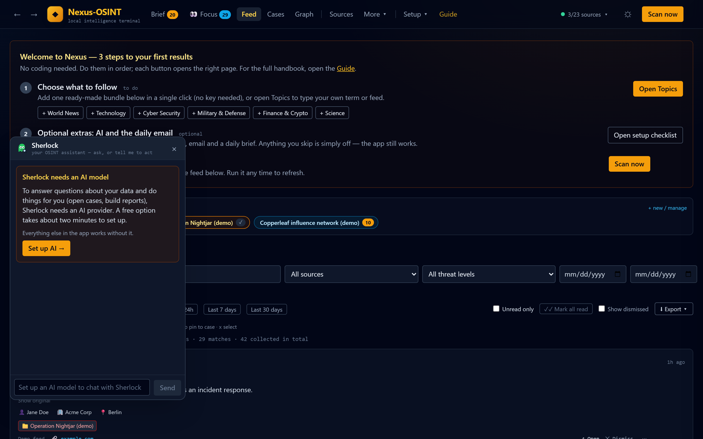

Sherlock, the in-app assistant (not the `sherlock` username CLI of the same
name), can open cases, add tracking words, pin matching items, run a scan and
build reports for you. It does that only through an **allow-list** of constructive,
local actions; it has no tool to delete data, change settings, read keys or
reach the network. Collected text is untrusted input, so the assistant's output
is rendered as text, never HTML: a prompt injection hidden in a scraped post
cannot become script execution in your browser.

#### 11. A setup checklist, and settings that explain themselves

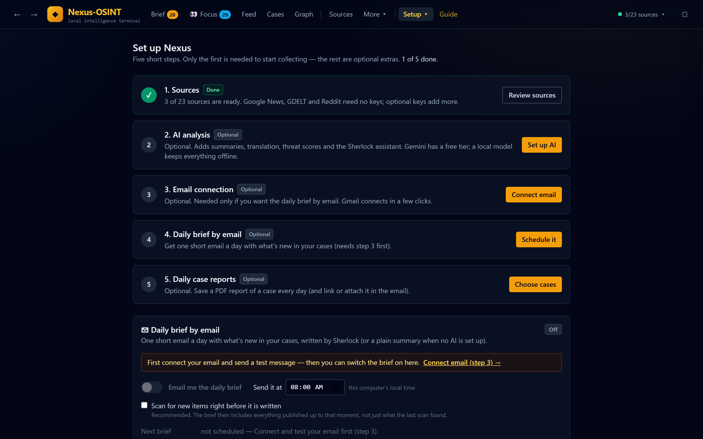

**Setup** walks through five short steps, each with a live status and one button:
sources (several work with no keys), an optional AI provider, the email
connection, the daily brief (on/off, local time, "scan first", a test send and
when it last went out / goes out next) and per-case daily reports. Only the
first step is needed to start collecting.

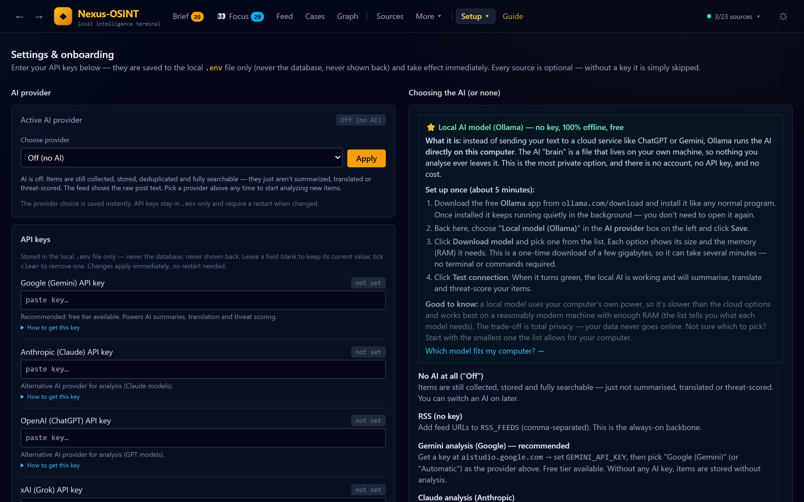

Pick an AI provider (cloud or a fully local model), paste keys, and configure
sources. Keys are written to the local `.env` only and are never shown back:
the UI only says *set* or *not set*. Each key has step-by-step instructions for
non-technical users.

Light theme

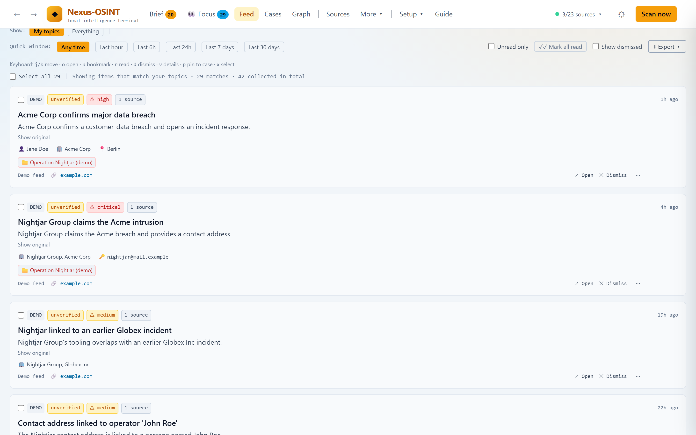

### Try the same demo yourself

After installing, click **Load demo data** on the empty feed. It inserts 42 fictional
items across three storylines (a data breach, port ransomware and a
disinformation network) and three cases, all tagged `demo` so they are easy to
delete. The screenshots are regenerated by
[`scripts/capture_screenshots.py`](../scripts/capture_screenshots.py).
